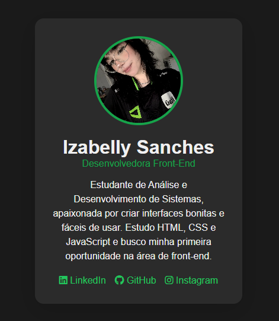

# Cartão de Perfil de Desenvolvedora

Cartão de perfil criado do zero com HTML5 e CSS3 para ser usado em um portfólio digital. O projeto foi desenvolvido como atividade prática sobre semântica, organização de layout e design responsivo básico.

## Visualização



## Tecnologias utilizadas

- HTML5, com tags semânticas
- CSS3, com Flexbox, transições e pseudo-classe `:hover`
- Font Awesome, para os ícones das redes sociais

## Estrutura do projeto

```
Cartão/
  html/
    foto.jpg
    image.png
    index.html
    style.css
    README.md
```

## O que o projeto contém

- Foto de perfil redonda, com borda colorida
- Nome, cargo e breve resumo profissional
- Links para redes sociais fictícias, com ícones correspondentes
- Cartão centralizado na tela com Flexbox
- Paleta de cores em tons de cinza, com detalhes em verde
- Efeito de aumento suave na foto e nos links ao passar o mouse

## Boas práticas aplicadas

- Uso de `main`, `section`, `header`, `figure` e `footer` para dar significado à estrutura da página
- Atributo `alt` descritivo na imagem de perfil
- Uso de `aria-label` na lista de redes sociais e `aria-hidden` nos ícones decorativos
- Meta tag `viewport` para a página se ajustar a telas de celular
- Comentários no HTML e no CSS explicando as principais tags e classes

## Como executar

1. Baixe ou clone este repositório.
2. Mantenha os arquivos `index.html`, `style.css` e `foto.jpg` na mesma pasta.
3. Abra o arquivo `index.html` no navegador.

## Autora

Izabelly Sanches, estudante de Análise e Desenvolvimento de Sistemas.
